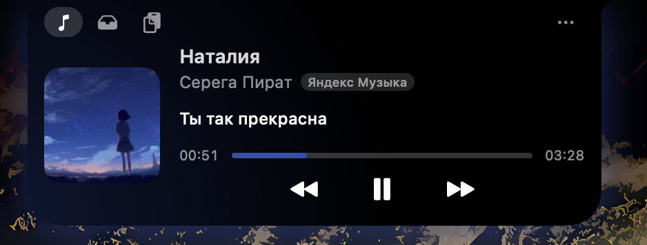

# NotchIsland

Динамический остров для MacBook с вырезом: музыка, буфер обмена, полка файлов,
переводчик и не только.

## Возможности
- Музыка: обложка, текст песни, управление и перемотка
- Буфер обмена и полка файлов
- Переводчик выделенного текста
- Превью скриншотов, уведомления о Bluetooth и зарядке

## Установка
1. Скачай `NotchIsland-x.y.zip` из [Releases](../../releases/latest).
2. Распакуй и перенеси `NotchIsland.app` в `/Applications`.
3. Приложение не нотаризовано, поэтому при первом запуске:
   правый клик → Открыть, либо `xattr -cr /Applications/NotchIsland.app`.

## Сборка из исходников
Нужны Xcode Command Line Tools (`xcode-select --install`):

    ./build.sh

## Выпуск релиза
См. [RELEASE_GUIDE.md](RELEASE_GUIDE.md): `./release.sh 1.1`.

## Если переводчик просит доступ, хотя он выдан
Приложение не нотаризовано, поэтому после обновления macOS может «не узнавать» старую запись в
Системные настройки → Конфиденциальность и безопасность → Универсальный доступ. Нажмите **Сбросить** на карточке
переводчика (или в Настройках → Переводчик) и выдайте доступ заново; если не помогло — **Перезапустить**.
Вручную: `tccutil reset Accessibility com.local.notchisland`.

Для сборки с постоянной подписью (права больше не слетают): создайте самоподписанный сертификат
«Связка ключей → Помощник сертификации → Создать сертификат → Подпись кода» и запустите
`SIGN_IDENTITY="Имя сертификата" ./build.sh`.

## Требования и ограничения
- macOS 13+, Apple Silicon
- Системный «Now Playing» один на всю систему: когда запускается YouTube, он вытесняет музыкальное приложение.
  При включённом «Только музыка» остров не показывает видео и оставляет последний трек (на паузе)
- Для «Now Playing» используется приватный MediaRemote API,
  поэтому в App Store приложение попасть не может

## Лицензия
MIT
